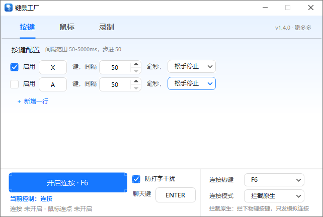
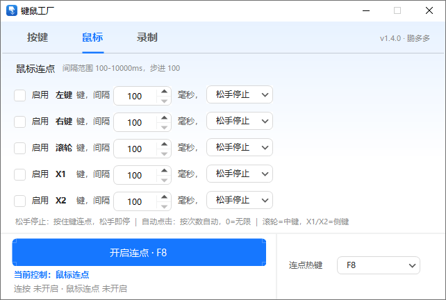
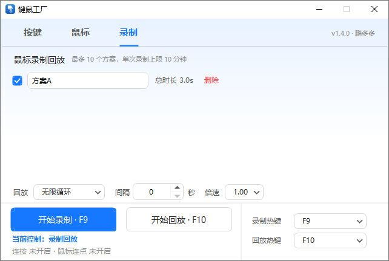

# 键鼠工厂

一个轻量的 Windows 桌面工具，支持按键连点、鼠标连点、鼠标轨迹录制回放。使用 C# / .NET 8 WinForms 编写，单文件 EXE、开箱即用、内存占用低。三页签：**连按 / 鼠标连点 / 轨迹录制与回放**。

| 连按 | 鼠标连点 | 轨迹录制与回放 |
| --- | --- | --- |
|  |  |  |

## 功能特性

- **按键连按**：最多 5 行配置，键名框里直接按目标键即可录入；间隔 50–5000ms，停止条件支持「松手停止」与「自动连按」（可设次数，0 为无限）
- **鼠标连点**：左键 / 右键 / 滚轮 / 两个侧键，五行独立配置；间隔 100–10000ms，同样支持松手停止与自动点击
- **轨迹录制与回放**：`F9` 录制、`F10` 回放，最多保存 10 个方案、单次录制上限 10 分钟；回放支持固定次数 / 无限循环 / 固定时长三种模式，可设轮间隔与 1.00–5.00 倍速
- **防打字干扰**（默认开启）：焦点离开游戏或按下聊天键（可自定义，默认 `ENTER`）时自动暂停连按、放行物理键，切回游戏自动恢复
- **全局热键**：连按 `F6`、连点 `F8`、录制 `F9`、回放 `F10`，均可修改，窗口收进托盘也能触发
- **托盘运行**：引擎开启后自动收进托盘，右下角浮条实时显示运行状态（鼠标穿透，不挡操作）；点窗口 X 可选「最小化到托盘」或退出
- **配置自动保存**：所有改动即时生效并自动落盘，下次启动自动加载

> 回放时的右下角状态条（只读、鼠标穿透，轨迹点过去也不受影响）：
>
> 

## 使用说明

1. 双击运行 `key-mouse-factory.exe`（无需安装。程序以管理员权限运行并弹 UAC——权限不足时注入的按键会被系统丢弃，原因见[技术实现](docs/ARCHITECTURE.md)）
2. 「按键」页：点键名框后直接按目标键，设好间隔与停止条件，勾选启用
3. 点「开启连按 · F6」或按热键：松手停止的行按住才连按，自动连按的行直接开跑
4. 「鼠标」页同理配置后点「开启连点 · F8」：勾选的行按住对应鼠标键即连点，松开即停
5. 「录制」页按 `F9` 开始录制（窗口收进托盘，右下角状态条可随时停止），录完自动保存为方案
6. 列表里勾选方案，选好模式、间隔与倍速，点「开始回放 · F10」或按热键；把游戏切到前台即可，再按 `F10` 立刻停
7. 任意配置改动都即时生效并自动保存，无需手动保存
8. 关闭窗口时选「最小化到托盘」程序继续后台运行；托盘右键「退出程序」彻底退出

> 注意：引擎运行中对应页面的配置区会锁定，先停止再编辑；连按与连点两个引擎互不影响，可同时开启。

## 支持的键位

键名框里**直接按目标键**就会填入键名，也可以手工输入或粘贴（非法键名会被清空并提示）。

| 类别 | 键名 | 说明 |
| --- | --- | --- |
| 字母 / 数字 | `A`–`Z`、`0`–`9` | 单字符 |
| 小键盘数字 | `N0`–`N9` | 与主键盘数字分开算 |
| 空格 | `SPC` | |
| 符号键 | `;` `=` `,` `-` `.` `/` `` ` `` `[` `\` `]` `'` | 按物理键位记录，不受键盘布局影响 |

范围只保留「游戏里会当技能键用」的键；F 键、方向键、修饰键等不支持的原因见[技术实现](docs/ARCHITECTURE.md#设计取舍)。

## 连按模式

| 模式 | 行为 | 适用场景 |
| --- | --- | --- |
| 拦截原生（默认） | 拦截键盘原生输入，由程序按设定间隔重复发送 | 游戏内使用，避免原生重复干扰 |
| 保留原生 | 原生按键正常生效，程序叠加模拟按键 | 需要保留系统级按键行为的场景 |

> 未开启「防打字干扰」时，「拦截原生」为全局拦截——连按开启期间系统任何位置都无法正常输入目标键，需临时输入请先按热键关闭连按。

## 热键

- 四个热键均全局生效（窗口在托盘也可触发）；单键开关，按一下开启、再按一下关闭
- 在各页签下方的卡片中随当前 Tab 编辑；热键互斥，已被占用的键在下拉列表里置灰不可选
- 热键被其他程序占用时，自动改用下一个空闲 F 键并写回配置（状态栏、托盘气泡与日志会提示）
- 程序单实例运行：再次双击 EXE 会把已运行的窗口唤到前台

## 数据文件

| 文件 | 位置 | 说明 |
| --- | --- | --- |
| `config.json` | EXE 同目录（无写权限时 `%APPDATA%\KeyMouseFactory\`） | 全部设置 |
| `recordings.json` | 同上 | 录制方案（含轨迹点），最多 10 个 |
| `error.log` | 同上 | 异常与操作日志，保留最近 200 行 |

字段含义、手工编辑与版本兼容说明见 [配置与数据文件](docs/CONFIG.md)。

## 下载

前往 [Releases](https://github.com/wp993080086/key-mouse-factory/releases) 下载最新版 `key-mouse-factory.exe`，单文件、无需安装，目标机器无需预装 .NET 运行时。

## 文档索引

面向使用者：

- [更新日志](CHANGELOG.md)（遵循 [Keep a Changelog](https://keepachangelog.com/zh-CN/1.1.0/) 规范）

面向开发者：

- [技术实现](docs/ARCHITECTURE.md) —— 钩子、注入、调度、录制回放与自绘 UI 的实现方式，以及键位范围、间隔下限等设计取舍
- [配置与数据文件](docs/CONFIG.md) —— `config.json` 字段、版本兼容、`recordings.json` 与日志
- [构建、测试与调试](docs/DEVELOPMENT.md) —— 源码构建、单元测试、Debug 专用调试参数
- [功能方案与落地记录](docs/PLAN.md) —— 功能方案的推演、实施计划与落地差异

## 免责声明

本工具仅供学习交流与个人效率用途，请遵守目标软件的用户协议与相关法律法规，使用本工具产生的一切后果由使用者自行承担。

## 开源许可

本项目基于 [MIT License](LICENSE) 开源。
